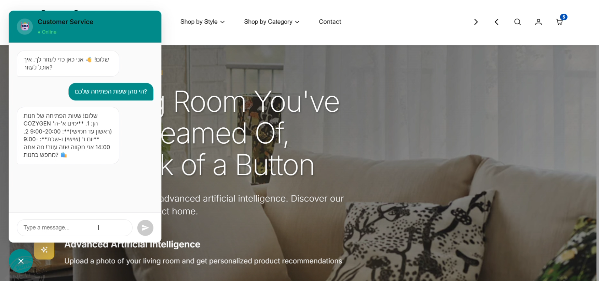
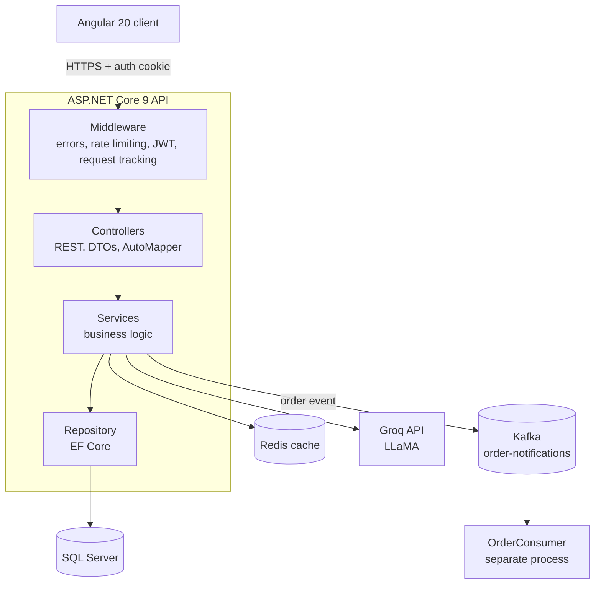
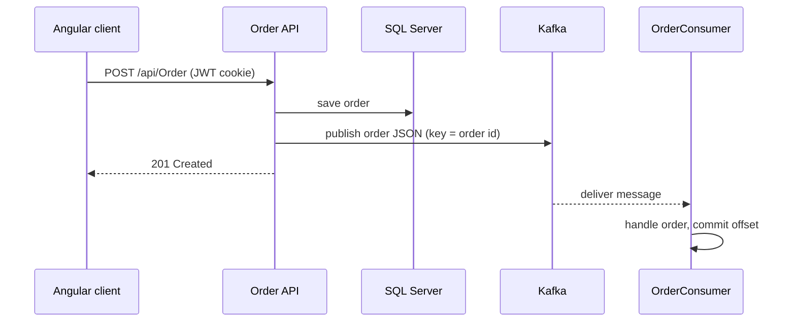

# CozyGen

Full-stack e-commerce platform for furniture and interior design, with AI-powered design help.

**Angular 20** client · **ASP.NET Core 9** Web API · **SQL Server** · **Redis** · **Kafka** · **Groq (LLaMA)**



## Features

- **Shop**: product catalog with filtering by price, category and style, paging, cart, checkout and order history
- **AI design assistant**: chat with a LLaMA model (via Groq) for product and design advice, and image analysis of a room to suggest matching products
- **Admin panel**: manage products, categories and styles, including image upload
- **Authentication**: JWT stored in an HttpOnly cookie, role-based authorization (`Customer` / `Admin`), BCrypt password hashing
- **Event-driven orders**: every new order is published to a Kafka topic and handled by a separate consumer process
- **Performance and resilience**: Redis cache with invalidation on writes, per-IP rate limiting, HTTP retry interceptor on the client
- **Observability**: NLog file logging, error-email alerts, centralized error-handling middleware, request tracking middleware

## Architecture

The server is a layered monolith: each layer depends only on the interface of the layer below it, wired with dependency injection.



### Order event flow



The checkout does not wait for the consumer. If the consumer is slow or down, orders are still accepted and the messages wait in Kafka until it comes back.

### Authentication

1. `POST /api/Users/Login` checks the BCrypt hash and returns the user plus a signed JWT (id, email, name, role).
2. The server also sets the JWT as an **HttpOnly** cookie (`auth_token`), so JavaScript can't read it.
3. The client sends the cookie with every request (`withCredentials`). The API validates it, and `[AuthorizeRole("Admin")]` protects admin endpoints.
4. Users can access only their own orders and profile. Admins can access everything.

## Tech stack

| Area | Technologies |
|---|---|
| Client | Angular 20, PrimeNG, RxJS, TypeScript |
| API | ASP.NET Core 9, C#, AutoMapper, Swagger |
| Data | SQL Server, Entity Framework Core (database first) |
| Cache | Redis (`IDistributedCache`) |
| Messaging | Apache Kafka (KRaft), Confluent.Kafka, Kafka UI |
| Security | JWT (HttpOnly cookie), BCrypt, role-based authorization, rate limiting |
| AI | Groq API: LLaMA 3.3 70B (chat), LLaMA 4 Scout (image analysis) |
| Logging | NLog (file + email) |
| Testing | xUnit, Moq, EF Core InMemory (unit + integration tests) |
| DevOps | Docker Compose |

## Getting started

### Prerequisites

- .NET 9 SDK, Node.js 20+, Docker Desktop, SQL Server (LocalDB/Express)

### 1. Configuration

```bash
cd server
cp .env.example .env   # then fill in the values
```

`server/.env` is git-ignored. It holds the JWT key, the SQL connection string, the Redis password, the Groq API key and the SMTP credentials.

### 2. Infrastructure (Redis, Kafka, Kafka UI)

```bash
cd server
docker compose up -d
```

Kafka UI: http://localhost:8080

### 3. API

```bash
cd server/Api
dotnet run
```

Or open `server/Api.sln` in Visual Studio and run the `Api` project. Swagger is available at `/swagger`.

### 4. Order consumer (separate terminal)

```bash
cd server/OrderConsumer
dotnet run
```

### 5. Client

```bash
cd client
npm ci
npm start
```

Open http://localhost:4200. The API address is set in `client/src/environments/environment.development.ts`.

### Tests

```bash
cd server
dotnet test
```

## Project structure

```
client/                 Angular app (pages, components, services, guards, interceptors)
server/
  Api/                  Controllers, middleware, auth, Program.cs
  Services/             Business logic, JWT, Kafka producer, AI service
  Repository/           EF Core DbContext and repositories
  Entities/             Database entities
  DTOs/                 Request/response contracts
  Tests/                Unit and integration tests
  OrderConsumer/        Kafka consumer (console app)
  docker-compose.yml    Redis, Kafka, Kafka UI
  .env.example          Required environment variables
docs/
  microservices-plan.md Plan for splitting the monolith into services
  screenshots/
```

## Roadmap

- Send the order-confirmation email from `OrderConsumer`
- Transactional outbox, so an order event is never lost if Kafka is down
- Split into microservices (Auth, Catalog, Order, AI, Notification) behind an API gateway. See [docs/microservices-plan.md](docs/microservices-plan.md)
